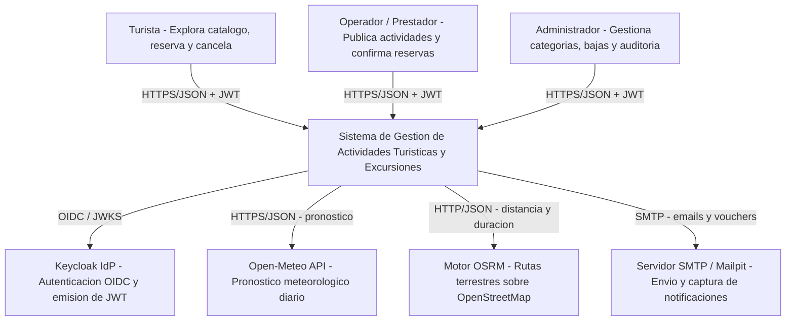
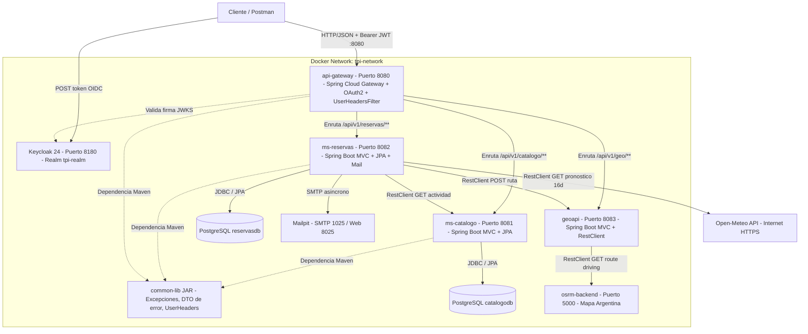
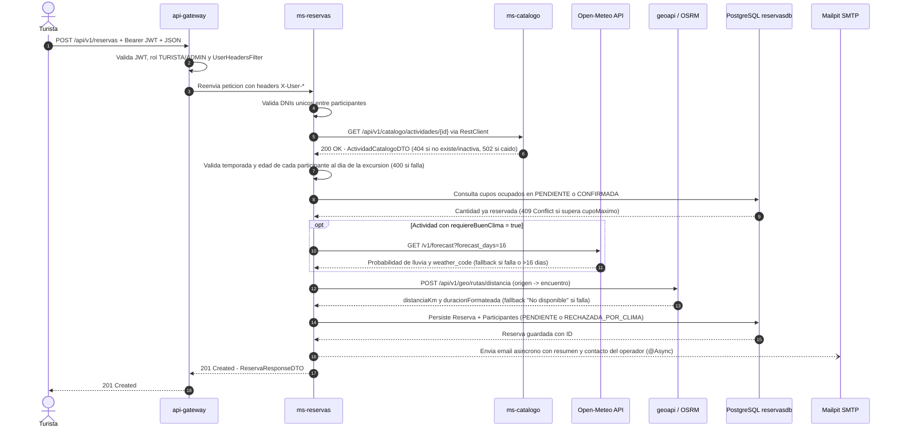
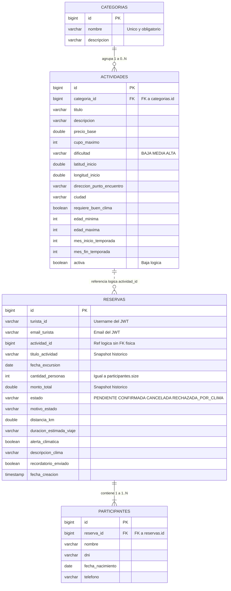

# Sistema de Gestión de Actividades Turísticas y Excursiones

**Trabajo Práctico Integrador — Backend de Aplicaciones (UTN FRC, 2026)**  
**Equipo 11** · Dominio 5: *Gestión de actividades turísticas y excursiones*

| Legajo | Integrante |
|---|---|
| 400623 | Correa, Emilia |
| 408944 | Mazzola, Octavio |
| 80046 | Medrano, Álvaro |
| 400249 | Villalba, Alex |
| 404720 | Palomeque, Maximiliano |

Plataforma backend basada en microservicios que administra la oferta de excursiones publicada por prestadores turísticos y gestiona el ciclo de vida completo de las reservas. El sistema no se limita a un CRUD: **evalúa y revalida la viabilidad de cada reserva** en función del cupo disponible, las restricciones de edad de los participantes, la temporada, el pronóstico meteorológico en tiempo real y el traslado terrestre hasta el punto de encuentro.

---

## 1. Stack Tecnológico

* **Lenguaje y Runtime:** Java 21
* **Framework:** Spring Boot 3.3.5 (Web, Data JPA, Validation, Mail, OAuth2 Resource Server) & Spring Cloud Gateway 2023.0.3
* **Persistencia:** PostgreSQL 16 en contenedores (una base por microservicio) y H2 en memoria para desarrollo local / tests
* **Seguridad:** Keycloak 24 (OpenID Connect / OAuth2 con tokens JWT stateless y RBAC)
* **Ruteo Geoespacial:** OSRM (`osrm/osrm-backend`) con mapa de Argentina (OpenStreetMap)
* **Clima:** API pública **Open-Meteo** (pronóstico de hasta 16 días)
* **Notificaciones:** SMTP asincrónico (`@Async`) capturado en desarrollo con **Mailpit**
* **Documentación e Infraestructura:** Springdoc OpenAPI / Swagger UI, Maven multi-módulo, Docker & Docker Compose

---

## 2. Arquitectura (Modelo C4)

### 2.1 Diagrama de Contexto — C4 Nivel 1



### 2.2 Diagrama de Contenedores — C4 Nivel 2



| Componente | Puerto | Responsabilidad |
|---|---|---|
| **`api-gateway`** | `8080` (público) | Único punto de entrada a las APIs. Valida el JWT contra Keycloak, aplica RBAC por ruta y método HTTP, y propaga la identidad mediante `UserHeadersFilter`. |
| **`ms-catalogo`** | `8081` (loopback local) | Administra categorías y actividades turísticas (precio, cupo máximo, punto de encuentro GPS, ciudad, requerimiento climático, edades y temporada). Realiza baja lógica. |
| **`ms-reservas`** | `8082` (loopback local) | Orquestador del proceso central de reservas. Valida reglas de negocio, coordina catálogo, Open-Meteo, GeoAPI, mails `@Async` y la revalidación de reservas vigentes. |
| **`geoapi`** | `8083` (loopback local) | Calcula distancias terrestres y duración estimada de viaje consumiendo el motor **OSRM**. |
| **`common-lib`** | JAR Maven | Biblioteca compartida con manejo global de errores (`GlobalExceptionHandler`), excepciones de negocio, `ErrorResponseDTO` y contrato de identidad (`UserHeaders`, `UsuarioAutenticado`). |
| **`keycloak`** | `8180` | Identity Provider OIDC. Importa automáticamente `keycloak/tpi-realm.json` al iniciar. |
| **`mailpit`** | `8025` web / `1025` SMTP | Captura y muestra en interfaz web todos los correos emitidos por `ms-reservas`. |
| **`postgres-db`** | `5432` (loopback local) | Instancia PostgreSQL 16 con dos bases lógicas separadas: `catalogodb` y `reservasdb`. |

---

## 3. Proceso Principal y Reglas de Negocio

### 3.1 Diagrama de Secuencia — Creación de Reserva (`POST /api/v1/reservas`)



### 3.2 Reglas de Negocio e Impacto ante Fallas

| Regla | Descripción | Respuesta / Efecto |
|---|---|---|
| **RN01 · Control de cupos** | Suma los participantes de reservas `PENDIENTE` + `CONFIRMADA` para esa actividad y fecha. | Si `yaReservadas + nuevos > cupoMaximo` → **`409 Conflict`**. |
| **RN02 · Viabilidad climática** | Si la actividad tiene `requiereBuenClima = true`, consulta Open-Meteo (ventana de 16 días). | Si `probabilidadLluvia > 70%` o `weatherCode >= 61` → se guarda como **`RECHAZADA_POR_CLIMA`** sin ocupar cupo y notifica por email. |
| **RN03 · Traslado terrestre** | Calcula distancia y duración en `geoapi` + `OSRM` desde el origen del turista hasta el punto de encuentro. | Guarda `distanciaKm` y `duracionEstimadaViaje` en la reserva. |
| **RN04 · Control de titularidad** | Un `TURISTA` solo puede consultar el detalle y cancelar **sus propias** reservas (identidad del JWT). | Si intenta operar sobre una reserva ajena → **`403 Forbidden`**. |
| **RN05 · Matriz de estados** | `inicio` → `PENDIENTE` / `RECHAZADA_POR_CLIMA`; `PENDIENTE` → `CONFIRMADA` / `CANCELADA`; `CONFIRMADA` → `CANCELADA`. | `CANCELADA` y `RECHAZADA_POR_CLIMA` son finales: cualquier transición inválida → **`400 Bad Request`**. |
| **Edad, temporada y DNI** | Valida edad mínima/máxima al día de la excursión, meses de temporada (admite cruce de año) y DNIs sin repetir. | Si no cumple → **`400 Bad Request`**. |

### 3.3 Revalidación de Reservas Vigentes (`POST /api/v1/reservas/revalidaciones`)

Responde al requisito de negocio *"una reserva inicialmente válida puede dejar de ser viable"*. Cuando el administrador ejecuta el endpoint de revalidación, se evalúan todas las reservas futuras en estado `PENDIENTE` o `CONFIRMADA`:
1. **Actividad dada de baja (`activa = false`):** todas sus reservas futuras pasan a `CANCELADA` con su `motivoEstado`.
2. **Cambio de temporada:** si la fecha quedó fuera de la nueva temporada, pasa a `CANCELADA`.
3. **Reducción de cupo:** se conservan las `CONFIRMADA` y se cancelan las `PENDIENTE` más recientes hasta respetar el nuevo cupo.
4. **Empeoramiento del pronóstico (próximos 16 días):** si requiere buen clima y el pronóstico es adverso, pasa a `RECHAZADA_POR_CLIMA`.
5. **Regla de 48 hs / 24 hs:** si faltan 48 hs y sigue `PENDIENTE`, se envía un único email de recordatorio (`recordatorioEnviado = true`); si faltan 24 hs y sigue `PENDIENTE`, se cancela automáticamente y libera el cupo.

### 3.4 Resiliencia y Degradación ante Fallas de Colaboradores

* **Caída de `ms-catalogo`:** Al crear una reserva devuelve **`502 Bad Gateway`** (es dato crítico: sin precio, cupo ni coordenadas no se puede reservar). En la revalidación, las reservas de esa actividad **no se cancelan** y se contabilizan en `actividadesNoVerificadas`.
* **Caída de `Open-Meteo` o `geoapi`/`OSRM`:** Aplican **fallback** — la reserva se registra igual (`201 Created`) con alerta climática en `false` (informando pronóstico no disponible) y traslado `"No disponible"`.
* **Caída de `Mailpit` (SMTP):** El envío corre con `@Async` dentro de `try/catch`; se registra en el log sin interrumpir la operación HTTP.

---

## 4. Persistencia y Diagrama Entidad-Relación (DER)

El sistema implementa **Database-per-Service** sobre PostgreSQL 16 (`init-db/01-init.sql` crea `reservasdb` junto a `catalogodb`):



**Decisiones clave de persistencia:**
* **Desacoplamiento entre bases:** `ms-reservas` nunca consulta directamente `catalogodb`; almacena solo `actividad_id` como referencia lógica validada vía HTTP (`RestClient`).
* **Desnormalización intencional:** `titulo_actividad` y `monto_total` se persisten en `reservas` para preservar el comprobante histórico si el prestador modifica precios o títulos posteriormente.
* **Baja lógica:** `DELETE /api/v1/catalogo/actividades/{id}` cambia `activa = false` sin borrar filas, manteniendo la trazabilidad histórica.

---

## 5. Seguridad, RBAC y Trusted Zone

1. **Autenticación con Keycloak:** El realm `tpi-realm` y el cliente `tpi-client` se importan automáticamente desde `keycloak/tpi-realm.json` con 4 usuarios listos para probar (contraseña `1234`):
   * `turista1` y `turista2` (rol `TURISTA`)
   * `operador1` (rol `OPERADOR`)
   * `admin1` (rol `ADMIN`)
2. **Validación en el Borde (`api-gateway`):** Configurado como OAuth2 Resource Server (`SecurityConfig.java`). Valida firma y expiración contra el endpoint JWKS de Keycloak, extrae roles de `realm_access.roles` (prefijo `ROLE_`) y aplica autorización por ruta y método (`401` sin token o inválido, `403` sin rol suficiente).
3. **Propagación Segura de Identidad (`UserHeadersFilter`):** Antes de reenviar cada petición, el Gateway **elimina** cualquier header `X-User-*` enviado por el cliente y vuelve a escribir `X-User-Id`, `X-User-Name`, `X-User-Email` y `X-User-Roles` desde el JWT validado. En `ms-reservas`, `UsuarioAutenticado.desde(request)` reconstruye al usuario para asignar la reserva y validar titularidad (RN04).
4. **Red Docker:** Todos los servicios corren dentro de `tpi-network`. Solo `api-gateway` (`8080`), `keycloak` (`8180`) y la web de `mailpit` (`8025`) se publican al exterior; PostgreSQL (`5432`) y los Swagger UI internos (`8081`–`8083`) quedan enlazados únicamente a `127.0.0.1`.

---

## 6. Módulo Común (`common-lib`)

Empaquetado como JAR Maven (`ar.edu.utn.frc.bda:common-lib`) y consumido por `ms-catalogo`, `ms-reservas` y `api-gateway`:
* **`GlobalExceptionHandler`** (registrado con `@Import(GlobalExceptionHandler.class)` en cada microservicio Servlet): unifica respuestas `400`, `403`, `404`, `405`, `409`, `502` y `500`.
* **Excepciones compartidas:** `BadRequestException`, `ForbiddenException`, `ResourceNotFoundException`, `ConflictException`.
* **`ErrorResponseDTO`:** `{ timestamp, status, error, message, path, validaciones }`.
* **`UserHeaders` y `UsuarioAutenticado`:** contrato de headers HTTP entre el Gateway y los microservicios.

Se excluyen deliberadamente las entidades JPA, repositorios y servicios de negocio para mantener la autonomía y despliegue independiente de cada microservicio.

---

## 7. Endpoints de la API (vía Gateway `http://localhost:8080`)

### Catálogo (`ms-catalogo` — `/api/v1/catalogo`)
| Método | Endpoint | Roles permitidos | Operación de negocio |
|---|---|---|---|
| `GET` | `/actividades` | Público | Lista actividades activas con filtros opcionales (`categoriaId`, `dificultad`, `precioMax`, `ciudad`). Sin coincidencias devuelve `200 OK` con `[]`. |
| `GET` | `/actividades/{id}` | Público | Detalle completo de una actividad (punto de encuentro GPS, cupo, edades, temporada, clima). |
| `GET` | `/actividades/{id}/disponibilidad` | Público | Estado activo y cupo máximo configurado. |
| `POST` | `/actividades` | `OPERADOR`, `ADMIN` | Publica una nueva actividad (`201 Created`). |
| `PUT` | `/actividades/{id}` | `OPERADOR`, `ADMIN` | Reemplazo completo de una actividad existente. |
| `PATCH` | `/actividades/{id}` | `OPERADOR`, `ADMIN` | Actualización parcial de atributos puntuales (ej. tarifa o cupo). |
| `DELETE` | `/actividades/{id}` | `ADMIN` | Baja lógica (`activa = false`, responde `204 No Content`). |
| `GET` | `/categorias`, `/categorias/{id}` | Público | Listado y detalle de categorías. |
| `POST` | `/categorias` | `ADMIN` | Crea una nueva categoría (`201 Created`). |
| `DELETE` | `/categorias/{id}` | `ADMIN` | Elimina categoría si no tiene actividades asociadas (`409 Conflict` si tiene). |

### Reservas (`ms-reservas` — `/api/v1/reservas`)
| Método | Endpoint | Roles permitidos | Operación de negocio |
|---|---|---|---|
| `POST` | `/` | `TURISTA`, `ADMIN` | Crea una reserva con sus participantes ejecutando toda la orquestación (`201 Created`). |
| `GET` | `/` | `ADMIN` | Auditoría global de todas las reservas del sistema. |
| `GET` | `/mis-reservas` | `TURISTA`, `ADMIN` | Reservas del turista identificado en el token JWT. |
| `GET` | `/{id}` | Autenticado | Detalle completo de una reserva (un `TURISTA` solo ve las propias; `403` si es ajena). |
| `GET` | `/actividad/{actividadId}` | `OPERADOR`, `ADMIN` | Listado de reservas asociadas a una excursión. |
| `PATCH` | `/{id}/confirmacion` | `OPERADOR`, `ADMIN` | Transición parcial `PENDIENTE → CONFIRMADA` y envío de voucher por email. |
| `PATCH` | `/{id}/cancelacion` | `TURISTA` (titular), `ADMIN` | Transición parcial `PENDIENTE/CONFIRMADA → CANCELADA`, libera cupo y notifica por email. |
| `POST` | `/revalidaciones` | `ADMIN` | Revalida reservas futuras vigentes (baja, temporada, cupo, clima y regla de 48 hs / 24 hs). |

### GeoAPI (`geoapi` — `/api/v1/geo`)
| Método | Endpoint | Roles permitidos | Operación de negocio |
|---|---|---|---|
| `POST` | `/rutas/distancia` | Autenticado | Calcula distancia en km y duración de viaje entre origen y destino usando OSRM. |
| `GET` | `/rutas/estimacion` | Autenticado | Estimación equivalente por query params (`latOrig`, `lonOrig`, `latDest`, `lonDest`). |
| `GET` | `/health-osrm` | `ADMIN` | Verifica el estado de conectividad con el contenedor OSRM. |

---

## 8. Ejecución y Verificación

### 8.1 Mapa de Argentina para OSRM (Opcional)
Los archivos preprocesados de OpenStreetMap superan los 4 GB y no se versionan en Git:
1. Descargar desde **[osrm-data (Google Drive)](https://drive.google.com/file/d/1KaBt7SngvWpoHdeLkjdckU9Nw5lSn9Yi/view?usp=sharing)**.
2. Descomprimir en la carpeta `osrm-data/` en la raíz del proyecto.
*(Si no se descargan, todo el sistema funciona igualmente en modo degradado devolviendo traslado `"No disponible"`).*

### 8.2 Compilación y Despliegue con Docker Compose

```bash
# 1. Compilar e instalar common-lib y empaquetar los JARs (opcional sin -DskipTests para correr pruebas)
mvn clean package -DskipTests

# 2. Levantar toda la infraestructura y microservicios (limpio)
docker compose down -v
docker compose up --build -d

# 3. Verificar estado de los contenedores
docker compose ps
```

> **Nota para Windows con Docker en WSL2:** abrir una sesión `wsl` y ejecutar `docker compose` dentro de Ubuntu, dejando la terminal abierta para que WSL no suspenda los contenedores en segundo plano.

| Servicio / Herramienta | URL Local | Credenciales / Uso |
|---|---|---|
| **API Gateway** | `http://localhost:8080` | Punto de entrada único para Postman / clientes |
| **Keycloak** | `http://localhost:8180` | Admin: `admin` / `admin` · Usuarios de prueba (`1234`): `turista1`, `turista2`, `operador1`, `admin1` |
| **Mailpit (Correos)** | `http://localhost:8025` | Bandeja web donde llegan todos los emails y vouchers |
| **Swagger `ms-catalogo`** | `http://localhost:8081/swagger-ui.html` | Contrato OpenAPI interactivo de Catálogo |
| **Swagger `ms-reservas`** | `http://localhost:8082/swagger-ui.html` | Contrato OpenAPI interactivo de Reservas |
| **Swagger `geoapi`** | `http://localhost:8083/swagger-ui.html` | Contrato OpenAPI interactivo de GeoAPI |

### 8.3 Pruebas Automatizadas y Colección Postman

* **Tests unitarios y de contexto Maven:**
  ```bash
  mvn clean test
  ```
* **Colección Postman ([`tpi_postman_collection.json`](tpi_postman_collection.json)):**
  Importar en Postman y ejecutar por carpetas o con el *Collection Runner* (44 peticiones organizadas en 6 carpetas, con scripts automáticos que capturan los JWT y encadenan IDs y fechas dinámicas):
  * `00 · Autenticación (Keycloak)`
  * `01 · Catálogo público (sin token)`
  * `02 · Gestión del catálogo (Operador / Admin)`
  * `03 · Reservas: proceso principal (camino feliz)`
  * `04 · Reservas: reglas de negocio (escenarios negativos)`
  * `05 · Revalidación: una reserva válida deja de ser viable`

### 8.4 Alternativa de Desarrollo Local (con H2 en memoria, sin contenedores Spring Boot)

```bash
mvn clean install -DskipTests
docker compose up -d keycloak
docker compose -f docker-compose.osrm.yml up -d   # opcional para OSRM en puerto 5000
mvn -pl ms-catalogo spring-boot:run
mvn -pl geoapi spring-boot:run
mvn -pl ms-reservas spring-boot:run
mvn -pl api-gateway spring-boot:run
```

En este modo local las bases de datos corren con H2 en memoria (consola web en `/h2-console` de cada servicio), Keycloak responde en `http://localhost:8180` y, al no estar publicado el SMTP fuera de Docker, los fallos de correo se registran en log sin afectar las reservas.
